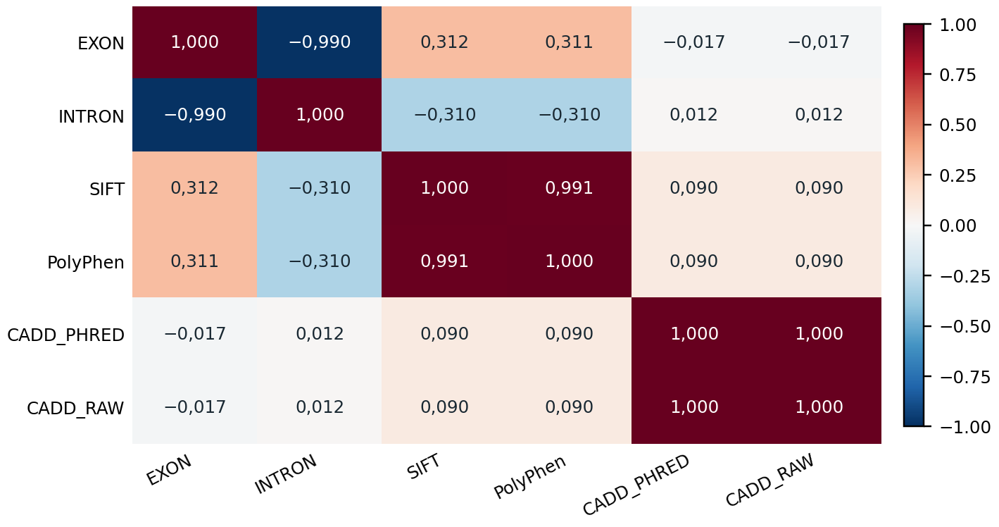
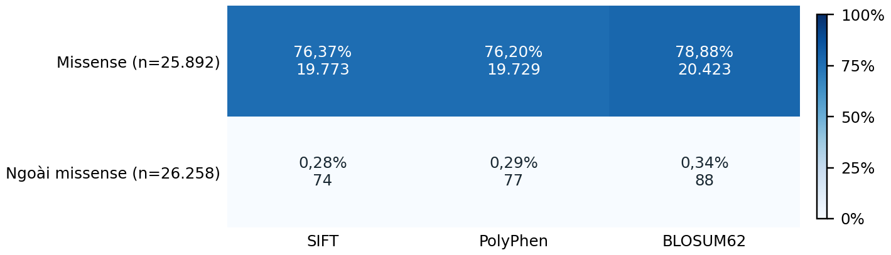

# Tiền xử lý và đánh giá đặc trưng ClinVar

Mục tiêu là dự đoán CLASS=1, tức diễn giải mâu thuẫn giữa các đánh giá ClinVar. Average precision (AP) đo khả năng xếp các biến thể lớp 1 lên đầu theo xác suất dự đoán.

### Hai cấu hình đã chọn

| Mô hình | Thay đổi so với mốc 24 đầu vào | Đầu vào → sau mã hóa | AP mốc → cuối |
| --- | --- | --- | --- |
| Logistic Regression | Log AF, ba cờ AF bằng 0, multi-hot hệ quả có nhóm hiếm | 27 → 56 | 0,3421 → 0,4208 |
| Random Forest | Giữ AF gốc, multi-hot hệ quả có nhóm hiếm | 24 → 53 | 0,4847 → 0,4957 |

AP cho CLASS=1 là trung bình không trọng số trên cùng 5 fold theo biến thể từ 52.150 dòng train. Bộ mốc locked_24 có 24 đầu vào và 83 cột sau mã hóa. [Tổng hợp CV](cv_summary.csv) · [Cấu hình đã xuất](selected.json)

Trong Logistic Regression, lợi ích chính đến từ log AF kết hợp ba cờ bằng 0. Khi thêm multi-hot có nhóm hiếm sau bước AF, AP đổi +0,00013 và số cột sau mã hóa giảm từ 86 xuống 56. Random Forest giữ AF gốc theo kết quả CV. [Kết quả từng cấu hình](cv_summary.csv)

### Cách gán nhãn CLASS và trường hợp VUS

Năm mức ý nghĩa lâm sàng khi diễn giải biến thể theo ACMG/AMP là gây bệnh (pathogenic), có khả năng gây bệnh (likely pathogenic), chưa rõ ý nghĩa (VUS), có khả năng lành tính (likely benign) và lành tính (benign). Các mức này mô tả kết luận về biến thể. CLASS ghi nhận tình trạng mâu thuẫn theo quy tắc của bộ dữ liệu. [Hướng dẫn ACMG/AMP](https://pmc.ncbi.nlm.nih.gov/articles/PMC4544753/)

Tác giả khởi tạo CLASS=0 và gán CLASS=1 khi CLNSIGCONF khác null. Bộ dữ liệu chỉ giữ hai giá trị CLNREVSTAT lịch sử gồm criteria_provided,_multiple_submitters,_no_conflicts và criteria_provided,_conflicting_interpretations. Tác giả bỏ CLNSIG, CLNSIGCONF và CLNREVSTAT trước khi xuất CSV. [Mã tạo bộ dữ liệu, dòng 89–109](https://github.com/arvkevi/clinvar-kaggle/blob/master/process_clinvar.py#L89-L109)

**VUS đi đâu?** Riêng mức VUS chưa đủ để suy ra CLASS. Trong phạm vi đã lọc, bản ghi có CLNSIGCONF khác null nhận lớp 1, còn trường null nhận lớp 0. Quy tắc cũng áp dụng cho pathogenic và benign. CLASS=0 nghĩa là không ghi nhận mâu thuẫn theo tiêu chí của bộ dữ liệu. Muốn đếm VUS theo lớp cần đối chiếu đúng bản VCF nguồn vì các trường cần thiết đã được bỏ khỏi CSV. [Mã tạo nhãn](https://github.com/arvkevi/clinvar-kaggle/blob/master/process_clinvar.py#L89-L109)

| Phạm vi | Biến thể | CLASS=1 |
| --- | --- | --- |
| Toàn bộ | 65.188 | 16.434 |
| Train | 52.150 | 13.147 |
| Test lịch sử | 13.038 | 3.287 |

Số dòng đếm theo source_row duy nhất. Cột CLASS=1 đếm nhãn bằng 1 trong từng tập. [Nhãn train](y_train.csv) · [Nhãn test](y_test.csv)

<!-- pagebreak -->

## Danh sách đầu vào cuối

| Nhóm | Tên cột đầu vào | Mô hình |
| --- | --- | --- |
| Điểm chú giải | CADD_RAW, LoFtool | Cả hai |
| Vị trí exon và intron | EXON_index, EXON_total, EXON_fraction, INTRON_index, INTRON_total, INTRON_fraction, transcript_region | Cả hai |
| Vị trí CDS và protein | CDS_position_start, CDS_position_span, Protein_position_start, Protein_position_span | Cả hai |
| Loại biến thể và hệ quả | CLNVC, IMPACT, BIOTYPE, Consequence | Cả hai |
| Có chú giải trong CSV | has_LoFtool, has_SIFT, has_PolyPhen, has_BLOSUM62 | Cả hai |
| AF biến đổi | log_AF_ESP, log_AF_EXAC, log_AF_TGP, zero_AF_ESP, zero_AF_EXAC, zero_AF_TGP | Logistic Regression |
| AF gốc | AF_ESP, AF_EXAC, AF_TGP | Random Forest |

Danh sách có 21 cột chung. Sáu dẫn xuất AF của Logistic Regression cho 27 đầu vào, mã hóa thành 56 cột. Ba AF gốc của Random Forest cho 24 đầu vào, mã hóa thành 53 cột. Số cột là độ dài schema đã fit trên toàn tập train. [Đầu vào Logistic Regression](LogisticRegression/input_columns.json) · [Đầu vào Random Forest](RandomForest/input_columns.json) · [56 cột sau mã hóa](LogisticRegression/feature_names.json) · [53 cột sau mã hóa](RandomForest/feature_names.json)

Giữ tỷ lệ và nhóm vùng của EXON/INTRON vì hai trường bổ sung nhau. Giữ điểm và cờ LoFtool. Các giá trị SIFT, PolyPhen, BLOSUM62 và tọa độ cDNA được bảo toàn trong bảng sạch. Đầu vào cuối của ba chú giải protein dùng cờ có giá trị trong CSV gốc.

<!-- pagebreak -->

## Độ phủ chú giải và các trường thường thiếu cùng nhau

**Hình 1. Các cột nào thường thiếu cùng nhau?** Tương quan Pearson giữa cờ thiếu 0/1 trên 52.150 dòng train. EXON/INTRON = −0,990, SIFT/PolyPhen = 0,991 và hai cờ thiếu CADD = 1,000. Bốn nhóm vùng có 44.988 chỉ exon, 7.035 chỉ intron, 31 có cả hai và 96 chưa xác định. Hai trường bổ sung nhau nên giữ cả hai. Hình của Sơn dùng 16 cột trên toàn bộ 65.188 dòng. [Ma trận cờ thiếu train](missing_indicator_corr_train.csv) · [Hình 12 của Sơn, mục 5.2](https://drive.google.com/drive/folders/1T5GGkzTAMNXZzxXAzhSQZfCwRPwkpaAt)

**Hình 2. Chú giải protein có mặt ở nhóm nào?** Tử số là số dòng có chú giải gốc, mẫu số là số dòng của nhóm train. Missense được xác định khi Consequence có từ missense_variant. Điểm BLOSUM62 khôi phục nằm ngoài tử số. [Số đếm độ phủ](audit_train.csv) · [Độ phủ theo hệ quả](../feature_study/coverage.png)

Trên train, khôi phục 5.442 điểm BLOSUM62 bằng 0 trong 5.469 ô thiếu missense khi cặp axit amin hợp lệ có điểm ma trận bằng 0. Còn 27 ô thiếu. Bảng sạch giữ điểm âm, chú giải ngoài missense, PolyPhen unknown và mức tin cậy SIFT. [Kiểm tra protein](audit_train.csv)

<!-- pagebreak -->

## Hai thang điểm CADD

**Hình 3. Hai thang điểm nào có thứ hạng gần trùng?** Mỗi ô ghi Spearman của giá trị điểm và số cặp cùng quan sát. CADD_PHRED/CADD_RAW có ρ ≈ 0,999985 trên 51.293 cặp từ train. Các ô hiển thị hệ số làm tròn. Ô thiếu ở một trong hai trường nằm ngoài phép tính. [Giá trị Spearman](../feature_study/spearman.csv) · [Số cặp](../feature_study/spearman_pair_counts.csv)

### CADD theo từng giai đoạn

| Giai đoạn | Thang điểm và xử lý thiếu |
| --- | --- |
| Bộ cơ sở lịch sử, 8 đầu vào | CADD_PHRED. Trung vị 14,06 học trên các giá trị PHRED hợp lệ trong toàn bộ 52.150 dòng train ở bản xuất lịch sử. |
| Bảng sạch trước nội suy | Giữ CADD_PHRED và CADD_RAW trước điền thiếu. |
| Bộ mốc mở rộng và hai cấu hình cuối | CADD_RAW. Bảo toàn cả điểm RAW âm hữu hạn. |
| Cross-validation | Học trung vị cột số từ phần huấn luyện của từng fold. Preprocessor xuất học trên toàn bộ train. |

Trung vị lịch sử 14,06 dùng 51.293 giá trị PHRED hợp lệ của train. Hình 1 đo sự đồng thời thiếu của hai thang. Hình 3 đo tương quan thứ hạng của các giá trị cùng có điểm. [Thống kê bộ cơ sở](../data/report.json) · [Schema mốc](../feature_study/pipeline/input_columns.json) · [Quy tắc điền thiếu](../preprocess.py)

<!-- pagebreak -->

## Tọa độ thiếu và độ phủ của cDNA

| Giá trị gốc | start | end | span | status |
| --- | --- | --- | --- | --- |
| 73 | 73 | 73 | 1 | single |
| 73-75 | 73 | 75 | 3 | range |
| 1476-? | 1476 | NaN | NaN | partial |
| ?-73 | NaN | 73 | NaN | partial |
| ? | NaN | NaN | NaN | unknown |
| Ô trống | NaN | NaN | NaN | missing |
| 75-73 | NaN | NaN | NaN | invalid |

Ví dụ tính bằng cùng quy tắc cho CDS, protein và cDNA. Tọa độ đơn có span = 1. Khoảng đầy đủ có span = end − start + 1. NaN trong bộ nhớ được ghi thành ô trống trong CSV. [Hàm tách tọa độ](../retained_features.py)

**1476-? qua ba bước.** Bảng sạch lưu start=1476, end=NaN, span=NaN và status=partial. Khi chuẩn bị CDS/protein, cả hai bộ cuối đặt start của dòng partial về NaN. span vẫn là NaN, còn end nằm ngoài schema cuối. Khi biến đổi, start và span thiếu nhận trung vị của cột tương ứng từ phần fit. [Hàm chuẩn bị X](../study_retained.py) · [Bộ điền thiếu](../preprocess.py)

cDNA được giữ trong bảng sạch và thử trong nhánh tọa độ với start, end, span, status và cờ có cDNA khi thiếu CDS. Cả hai bộ cuối dùng start và span của CDS/protein. 1476 là tọa độ trên CDS. Muốn tính tỷ lệ chiều dài cần chiều dài CDS của đúng transcript làm mẫu số.

### Đếm dòng có cDNA và thiếu CDS trên train

| Nhóm hệ quả | Tổng dòng trong nhóm | Có cDNA và thiếu CDS |
| --- | --- | --- |
| Toàn bộ train | 52.150 | 860 |
| 5′ UTR | 519 | 518 |
| 3′ UTR | 345 | 342 |

Đếm source_row duy nhất trong 52.150 dòng train. Tử số lọc cDNA_position có giá trị và CDS_position thiếu theo quy ước ký hiệu thiếu. Mẫu số 519 và 345 là số dòng train chứa hệ quả 5′ UTR và 3′ UTR tương ứng. Hai nhóm giao 0 dòng trên train và 0 dòng trong tử số. Có 0 dòng thỏa điều kiện bên ngoài hai nhóm. [Bảng sạch train](clean_train.csv) · [Số đếm kiểm tra](audit_train.csv)

<!-- pagebreak -->

## Bằng chứng chọn và loại thử nghiệm

So từng mô hình với chính mô hình đó dùng locked_24. Quy tắc yêu cầu đủ 5 fold hợp lệ ở cả bốn tổ hợp biến thể/gene × toàn tập/missense. ΔAP toàn tập theo biến thể phải đạt ít nhất +0,002 và tăng ở ít nhất 4/5 fold. Không tổ hợp nào được có ΔAP dưới −0,002. Các điều kiện được tính trên số chưa làm tròn. Trong các cấu hình đạt, chọn ΔAP toàn tập theo biến thể cao nhất. [Quy tắc chọn](../study_retained.py)

| Mô hình và thử nghiệm | AP mốc → thử | ΔAP | Fold tăng | Căn cứ |
| --- | --- | --- | --- | --- |
| Logistic Regression · Tọa độ bổ sung | 0,3421 → 0,3429 | +0,00077 | 4/5 | Dưới ngưỡng +0,002 |
| Logistic Regression · CHROM one-hot | 0,3421 → 0,3523 | +0,01015 | 5/5 | ΔAP toàn tập theo gene −0,01070 |
| Random Forest · Hệ quả nhóm hiếm | 0,4847 → 0,4957 | +0,01106 | 5/5 | Đủ 5 fold ở cả bốn tổ hợp, đạt mọi ngưỡng |

AP và ΔAP trong bảng đo trên toàn tập, chia theo biến thể. ΔAP là trung bình chênh lệch AP thử trừ mốc theo từng fold. Cột fold tăng đếm fold có ΔAP > 0. [Tổng hợp thử nghiệm](cv_summary.csv) · [Kết quả ghép cặp](cv_folds.csv)

Nhánh tọa độ tăng ở 4/5 fold cho Logistic Regression, nhưng mức tăng trung bình +0,00077 thấp hơn +0,002. CHROM đạt mức tăng và số fold theo biến thể, nhưng mức giảm −0,01070 trên toàn tập theo gene vượt giới hạn. Random Forest với hệ quả nhóm hiếm đạt +0,01106 trên toàn tập theo biến thể, +0,00954 trên missense theo biến thể, +0,01027 trên toàn tập theo gene và +0,00368 trên missense theo gene. [ΔAP theo bốn tổ hợp](cv_summary.csv)

| Nhóm CV trên train | Logistic Regression | Random Forest |
| --- | --- | --- |
| Missense theo biến thể | 0,2803 → 0,4052 | 0,4804 → 0,4899 |
| Toàn tập theo gene | 0,3275 → 0,4147 | 0,4523 → 0,4626 |
| Missense theo gene | 0,2680 → 0,3948 | 0,4467 → 0,4503 |

AP mốc → cuối, trung bình không trọng số của 5 fold trong từng nhóm. Mỗi dòng thuộc đúng một fold trong mỗi cách chia. [Phân bổ fold](fold_assignments.csv) · [AP theo nhóm](cv_summary.csv)

<!-- pagebreak -->

## CHROM và tần suất gene SYMBOL

Quy tắc để chọn feature yêu cầu đủ 5 fold trong cả bốn tổ hợp biến thể/gene × toàn tập/missense, ΔAP toàn tập theo biến thể ≥ +0,002, ít nhất 4/5 fold tăng và mọi ΔAP trung bình ≥ −0,002. Dung sai giảm áp dụng riêng cho từng tổ hợp. [Quy tắc chọn](../study_retained.py)

| Thử nghiệm | Bộ mốc | ΔAP biến thể | ΔAP theo gene |
| --- | --- | --- | --- |
| CHROM · Logistic Regression | locked_24 | +0,0102 | −0,0107 |
| Tần suất SYMBOL · Logistic Regression | Baseline one-hot | +0,0101 | −0,0002 |
| Tần suất SYMBOL · Random Forest | Baseline one-hot | +0,0353 | −0,0094 |

Mỗi ô là trung bình ΔAP trên toàn tập ở 5 fold train, theo đúng bộ mốc của hàng đó. [Kết quả CHROM](cv_summary.csv) · [Kết quả SYMBOL lịch sử](../feature_study/gene_fold_metrics.csv)

CHROM vượt giới hạn giảm trên gene chưa gặp. Với Logistic Regression lịch sử, mức giảm toàn tập theo gene của tần suất SYMBOL nằm trong dung sai. Cần thử lại trên đúng bộ mốc hiện tại và kiểm tra cả missense trước khi quyết định thêm feature. Với Random Forest lịch sử, mức giảm toàn tập theo gene vượt dung sai. Tần suất của gene chưa xuất hiện trong phần fit được mã hóa thành 0. Trong cấu hình hiện tại, SYMBOL phục vụ chia fold theo gene. [Mã hóa tần suất](../feature_study.py)

<!-- pagebreak -->

## Thử riêng từng mút tọa độ

A là cấu hình cuối hiện tại của mỗi mô hình. B giữ start đã biết trong cột CDS_position_start hoặc Protein_position_start hiện có. C giữ cách xử lý của B và thêm hai cột số CDS_position_partial_end, Protein_position_partial_end cùng hai cột phân loại CDS_position_partial_endpoint, Protein_position_partial_endpoint. Các mức phân loại là start_only, end_only hoặc other. span của khoảng thiếu một mút tiếp tục để thiếu trước nội suy.

CDS và protein cùng có khoảng partial trên 35 biến thể train, gồm 8 mẫu dương. B khôi phục start trên 25 dòng. C có end quan sát trên 10 dòng và ghi trạng thái mút trên cả 35 dòng. So B với A để đo riêng việc giữ start. So C với B để đo bước bổ sung end và trạng thái. Cả ba chạy trên cùng fold, cùng tham số và cùng quy trình fit.

| Mô hình và nhánh | AP biến thể | Δ so với A | Δ so với B | AP theo gene |
| --- | --- | --- | --- | --- |
| Logistic Regression · A | 0,4208 | +0,00000 | — | 0,4147 |
| Logistic Regression · B | 0,4206 | −0,00022 | — | 0,4145 |
| Logistic Regression · C | 0,4206 | −0,00028 | −0,00005 | 0,4146 |
| Random Forest · A | 0,4957 | +0,00000 | — | 0,4626 |
| Random Forest · B | 0,4965 | +0,00080 | — | 0,4601 |
| Random Forest · C | 0,4889 | −0,00685 | −0,00764 | 0,4582 |

AP lớp 1 bình quân 5 fold toàn tập train. So với A bằng tiêu chí ở phần trước. Logistic Regression chọn A. Random Forest chọn A. [AP và số fold tăng cho bốn tổ hợp](endpoint_review/cv_summary.csv) · [AP từng fold](endpoint_review/cv_folds.csv)

**Logistic Regression.** Nhánh B — Δ dưới ngưỡng, dưới 4 fold tăng. Nhánh C — Δ dưới ngưỡng, dưới 4 fold tăng.

**Random Forest.** Nhánh B — Δ dưới ngưỡng, giảm quá giới hạn. Nhánh C — Δ dưới ngưỡng, dưới 4 fold tăng, giảm quá giới hạn.

| So sánh trên 35 dòng | Số xác suất đổi | TB độ đổi tuyệt đối | Độ đổi lớn nhất |
| --- | --- | --- | --- |
| Logistic Regression · B so với A | 35 | 0,02062 | 0,10887 |
| Logistic Regression · C so với B | 35 | 0,08730 | 0,35910 |
| Random Forest · B so với A | 35 | 0,01711 | 0,06843 |
| Random Forest · C so với B | 35 | 0,02444 | 0,10935 |

Độ thay đổi tuyệt đối của xác suất ngoài fold theo biến thể. Mỗi so sánh có 35 dòng. Ngưỡng đếm thay đổi là 10⁻¹². Phân tích nhóm nhỏ mang tính thăm dò vì chỉ có 8 mẫu dương. [Xác suất theo từng dòng ở cả hai cách chia](endpoint_review/partial_oof.csv)

<!-- pagebreak -->

## AP và ngưỡng quyết định lớp

Random Forest đạt AP 0,4957 và F1 ngoài fold 0,5383. Với Logistic Regression, hai chỉ số tương ứng là 0,4208 và 0,5053.

AP lớp 1 dùng để chọn feature. Sau khi cố định cấu hình, chọn một ngưỡng cho mỗi mô hình bằng cách tối đa hóa F1 lớp 1 trên xác suất ngoài fold của toàn bộ train. Khi nhiều ngưỡng có cùng F1, lấy ngưỡng cao nhất. F1 trên tập xác suất dùng để chọn ngưỡng được ghi riêng.

| Mô hình | AP CV | Ngưỡng OOF | F1 chọn ngưỡng | Precision ngoài | Recall ngoài | F1 ngoài |
| --- | --- | --- | --- | --- | --- | --- |
| Logistic Regression | 0,4208 | 0,2396 | 0,5056 | 0,3981 | 0,6914 | 0,5053 |
| Random Forest | 0,4957 | 0,2647 | 0,5405 | 0,4281 | 0,7248 | 0,5383 |

AP là trung bình 5 fold theo biến thể. Precision, recall và F1 ngoài được tính bằng cách gộp dự đoán nhị phân của 52.150 dòng validation, gồm 13.147 mẫu dương. Với mỗi fold ngoài, chọn ngưỡng trên xác suất ngoài fold của bốn fold bên trong phần fit, rồi áp lên fold ngoài. Vì vậy ba cột hiệu năng ngoài dùng ngưỡng riêng từng fold, còn cột ngưỡng OOF là giá trị chốt từ toàn bộ train. [Tổng hợp AP và F1](endpoint_review/operating_metrics.csv) · [Ngưỡng và hiệu năng từng fold](endpoint_review/threshold_folds.csv)

Đây là đánh giá nội bộ với cấu hình đã cố định. Ngưỡng và kết quả test của bộ 24 cột lịch sử thuộc cấu hình lịch sử. Kết quả cho hai cấu hình hiện tại dùng train. [Mã tái lập](../study_endpoints.py)

<!-- pagebreak -->

## Phân tích các biến thể bị bỏ sót

Trong 2.978 biến thể lớp 1 có cả ba tần suất alen bằng 0, Random Forest bỏ sót 2.107 trường hợp (70,8%) và Logistic Regression bỏ sót 2.437 trường hợp (81,8%).

| Phép phân nhóm | Mô hình | Tỷ lệ bỏ sót cao nhất | Nhiều ca bỏ sót nhất |
| --- | --- | --- | --- |
| Vùng transcript | Logistic Regression | Cả exon và intron — 6/7 (85,7%) † | Chỉ exon — 3.712/11.230 (33,1%) |
| Vùng transcript | Random Forest | Cả exon và intron — 7/7 (100,0%) † | Chỉ exon — 3.368/11.230 (30,0%) |
| Chú giải trong missense | Logistic Regression | Có chú giải protein — 2.275/6.507 (35,0%) | Có chú giải protein — 2.275/6.507 (35,0%) |
| Chú giải trong missense | Random Forest | Có chú giải protein — 2.184/6.507 (33,6%) | Có chú giải protein — 2.184/6.507 (33,6%) |
| Tần số alen | Logistic Regression | Cả ba AF bằng 0 — 2.437/2.978 (81,8%) | Cả ba AF bằng 0 — 2.437/2.978 (81,8%) |
| Tần số alen | Random Forest | Cả ba AF bằng 0 — 2.107/2.978 (70,8%) | Cả ba AF bằng 0 — 2.107/2.978 (70,8%) |
| Loại CLNVC | Logistic Regression | Inversion — 3/3 (100,0%) † | single_nucleotide_variant — 3.843/12.563 (30,6%) |
| Loại CLNVC | Random Forest | Inversion — 3/3 (100,0%) † | single_nucleotide_variant — 3.380/12.563 (26,9%) |

Mỗi ô ghi FN/số mẫu CLASS=1 trong nhóm và tỷ lệ bỏ sót FN/(TP+FN). Dự đoán ngoài fold theo biến thể gồm 52.150 dòng mỗi mô hình, trong đó có 13.147 mẫu dương. Phép so sánh chú giải protein chỉ dùng 25.892 dòng train mang token missense_variant, và dùng cờ có điểm SIFT, PolyPhen hoặc BLOSUM62 trong CSV gốc. Các phép phân nhóm có thể chồng lấn, nên đọc riêng từng phép so sánh. Dấu † ghi nhóm có dưới 30 mẫu dương. Trong CSV, NA biểu thị chỉ số có mẫu số bằng 0. [Ma trận nhầm lẫn theo nhóm](endpoint_review/error_by_subgroup.csv) · [Dự đoán ngoài fold từng biến thể](endpoint_review/oof_predictions.csv)

<!-- pagebreak -->

## Đánh giá trên vị trí nhiễm sắc thể mới

Khi đánh giá tại vị trí chưa gặp, Random Forest đạt AP 0,4926 và F1 0,5401. Hai chỉ số của Logistic Regression đều thay đổi dưới 0,001.

| Mô hình | Cách chia | AP | Precision | Recall | F1 |
| --- | --- | --- | --- | --- | --- |
| Logistic Regression | Biến thể | 0,4208 (0,0062) | 0,3981 (0,0067) | 0,6914 (0,0167) | 0,5053 (0,0075) |
| Logistic Regression | Vị trí CHROM + POS | 0,4209 (0,0073) | 0,3957 (0,0088) | 0,6982 (0,0124) | 0,5051 (0,0090) |
| Random Forest | Biến thể | 0,4957 (0,0086) | 0,4281 (0,0097) | 0,7248 (0,0272) | 0,5383 (0,0064) |
| Random Forest | Vị trí CHROM + POS | 0,4926 (0,0111) | 0,4298 (0,0096) | 0,7268 (0,0263) | 0,5401 (0,0055) |

Cả hai cách chia dùng 52.150 dòng train gồm 13.147 mẫu dương. Phép chia theo vị trí có 50.829 khóa CHROM + POS. Mọi alen cùng vị trí vào chung một fold. Mỗi fold có cả hai lớp và không có vị trí giao giữa fit và validation. Ngưỡng F1 học ở vòng trong trên các nhóm vị trí thuộc phần fit. Vị trí mới nghĩa là chưa gặp tổ hợp CHROM + POS trong phần fit, và cùng gene vẫn có thể xuất hiện ở hai phía. [Phân bổ vị trí](endpoint_review/site_fold_assignments.csv) · [Kết quả từng fold và kiểm tra trùng vị trí](endpoint_review/site_cv_folds.csv)

AP là trung bình không trọng số của 5 fold. Precision, recall và F1 tính từ các dự đoán nhị phân gộp. Số trong ngoặc là độ lệch chuẩn mẫu của chỉ số qua 5 fold, dùng để mô tả độ dao động. Hai cách chia có thành phần fold khác nhau nên so chênh lệch tổng thể. [So sánh đầy đủ hai cách chia](endpoint_review/cv_by_split_comparison.csv) · [Tổng hợp theo vị trí](endpoint_review/site_cv_summary.csv) · [Dự đoán ngoài fold theo vị trí](endpoint_review/site_oof_predictions.csv)

**Logistic Regression.** Chia theo vị trí so với chia theo biến thể cho ΔAP +0,00009 và ΔF1 −0,00016.

**Random Forest.** Chia theo vị trí so với chia theo biến thể cho ΔAP −0,00311 và ΔF1 +0,00187.

<!-- pagebreak -->

## Phụ lục thử nghiệm Logistic Regression

| Thay đổi | AP mốc → thử | ΔAP | Fold tăng | ΔAP thấp nhất | Quyết định |
| --- | --- | --- | --- | --- | --- |
| AF gốc + cờ 0 | 0,3421 → 0,4149 | +0,07274 | 5/5 | +0,07274 | Đạt, xếp sau |
| Log AF | 0,3421 → 0,3213 | −0,02081 | 0/5 | −0,02081 | Chưa đủ phép đo |
| Log AF + cờ 0 | 0,3421 → 0,4207 | +0,07856 | 5/5 | +0,07856 | Đạt, xếp sau |
| Cờ có CADD_RAW | 0,3421 → 0,3423 | +0,00014 | 3/5 | −0,00005 | Chưa đủ phép đo |
| Giá trị protein | 0,3421 → 0,3419 | −0,00026 | 2/5 | −0,00129 | Δ dưới ngưỡng, dưới 4 fold tăng |
| Tọa độ bổ sung | 0,3421 → 0,3429 | +0,00077 | 4/5 | +0,00048 | Δ dưới ngưỡng |
| Hệ quả nhóm hiếm | 0,3421 → 0,3421 | −0,00005 | 2/5 | −0,00015 | Δ dưới ngưỡng, dưới 4 fold tăng |
| IMPACT thứ bậc | 0,3421 → 0,3423 | +0,00016 | 3/5 | −0,00029 | Δ dưới ngưỡng, dưới 4 fold tăng |
| CHROM one-hot | 0,3421 → 0,3523 | +0,01015 | 5/5 | −0,01070 | giảm quá giới hạn |
| Log AF + cờ 0 + hệ quả nhóm hiếm | 0,3421 → 0,4208 | +0,07869 | 5/5 | +0,07869 | Đã chọn |

AP và số fold tăng tính trên toàn tập theo biến thể. ΔAP thấp nhất lấy trong các tổ hợp có kết quả. Các dòng “Chưa đủ phép đo” thiếu ít nhất một tổ hợp 5 fold và không được xếp hạng. Các điều kiện bị vi phạm cho biết lý do không đạt. “Đạt, xếp sau” là cấu hình qua ngưỡng nhưng có AP toàn tập theo biến thể thấp hơn bộ cuối. Tra từng fold bằng config, model, scheme, subgroup và fold. [Tổng hợp](cv_summary.csv) · [Chỉ số theo fold](cv_folds.csv)

### Giải nghĩa nhánh thử

**Tọa độ bổ sung.** Thêm CDS_position_end, CDS_position_status, Protein_position_end, Protein_position_status, cDNA_position_start, cDNA_position_end, cDNA_position_span, cDNA_position_status, has_cDNA_without_CDS. Giữ mút start đã biết của khoảng partial trong nhánh này.

**Giá trị protein.** Thêm SIFT_call, SIFT_low_confidence, PolyPhen, BLOSUM62_score, BLOSUM62_source vào bộ mốc đã có cờ hiện diện.

**Các nhánh khác.** Log AF thay ba AF gốc. Cờ AF và cờ có CADD_RAW thêm các chỉ báo tương ứng. IMPACT thứ bậc thay one-hot bằng mã 0–3. CHROM thêm one-hot. Hệ quả nhóm hiếm thay one-hot cả chuỗi bằng multi-hot theo từng từ. [Định nghĩa các nhánh](../study_retained.py)

<!-- pagebreak -->

## Phụ lục thử nghiệm Random Forest

| Thay đổi | AP mốc → thử | ΔAP | Fold tăng | ΔAP thấp nhất | Quyết định |
| --- | --- | --- | --- | --- | --- |
| AF gốc + cờ 0 | 0,4847 → 0,4860 | +0,00129 | 4/5 | −0,00293 | Δ dưới ngưỡng, giảm quá giới hạn |
| Log AF | 0,4847 → 0,4847 | −0,00001 | 2/5 | −0,00012 | Chưa đủ phép đo |
| Log AF + cờ 0 | 0,4847 → 0,4859 | +0,00123 | 4/5 | −0,00288 | Δ dưới ngưỡng, giảm quá giới hạn |
| Cờ có CADD_RAW | 0,4847 → 0,4828 | −0,00189 | 2/5 | −0,00189 | Chưa đủ phép đo |
| Giá trị protein | 0,4847 → 0,4801 | −0,00453 | 0/5 | −0,00511 | Δ dưới ngưỡng, dưới 4 fold tăng, giảm quá giới hạn |
| Tọa độ bổ sung | 0,4847 → 0,4741 | −0,01058 | 0/5 | −0,01127 | Δ dưới ngưỡng, dưới 4 fold tăng, giảm quá giới hạn |
| Hệ quả nhóm hiếm | 0,4847 → 0,4957 | +0,01106 | 5/5 | +0,00368 | Đã chọn |
| IMPACT thứ bậc | 0,4847 → 0,4814 | −0,00332 | 0/5 | −0,00332 | Δ dưới ngưỡng, dưới 4 fold tăng, giảm quá giới hạn |
| CHROM one-hot | 0,4847 → 0,4836 | −0,00105 | 3/5 | −0,01212 | Δ dưới ngưỡng, dưới 4 fold tăng, giảm quá giới hạn |
| Log AF + cờ 0 + hệ quả nhóm hiếm | 0,4847 → 0,4946 | +0,00990 | 5/5 | +0,00650 | Đạt, xếp sau |

AP và số fold tăng tính trên toàn tập theo biến thể. ΔAP thấp nhất lấy trong các tổ hợp có kết quả. Các dòng “Chưa đủ phép đo” thiếu ít nhất một tổ hợp 5 fold và không được xếp hạng. Các điều kiện bị vi phạm cho biết lý do không đạt. “Đạt, xếp sau” là cấu hình qua ngưỡng nhưng có AP toàn tập theo biến thể thấp hơn bộ cuối. Tra từng fold bằng config, model, scheme, subgroup và fold. [Tổng hợp](cv_summary.csv) · [Chỉ số theo fold](cv_folds.csv)

Hệ quả có dưới 50 dòng fit hoặc chỉ gặp lúc validation bật nhóm hiếm. Hệ quả trống có cờ riêng. Trung vị, chuẩn hóa và từ vựng được fit lại ở từng fold. Các mô tả cột thử ở phụ lục Logistic Regression áp dụng cho cả hai mô hình. [Bộ mã hóa hệ quả](../consequence_encoder.py)

<!-- pagebreak -->

## Phụ lục kiểm chứng và test lịch sử

| Mô hình | AP cơ sở 8 trường | AP bộ 24 đã khóa |
| --- | --- | --- |
| Logistic Regression | 0,3367 | 0,3508 |
| Random Forest | 0,4652 | 0,4919 |

AP CLASS=1 đo một lần trên test lịch sử 13.038 dòng, gồm 3.287 mẫu dương. Bộ cơ sở one-hot dùng 8 trường gốc. Bộ mở rộng lịch sử dùng 24 đầu vào, 83 cột sau mã hóa. Test của lần cập nhật mới phục vụ kiểm tra phép biến đổi. [Chỉ số test lịch sử](../feature_study/holdout_threshold_metrics.csv)

### Nghiệm thu bảng sạch

Trên 52.150 dòng train, đếm theo hai trường phân số hợp lệ cho 44.988 chỉ exon, 7.035 chỉ intron, 31 có cả hai và 96 chưa xác định. Nhóm chưa xác định gồm dòng thiếu cả hai trường hợp lệ. [Số đếm vùng và lỗi cú pháp](audit_train.csv)

Cả 27 kiểm thử đều đạt trong lần bàn giao. Bốn ma trận khớp từng phần tử khi đọc lại CSV và nạp lại preprocessor. Mã dòng và nhãn căn đúng thứ tự, khóa biến thể giữa train và test tách biệt, tên cột duy nhất và dữ liệu ma trận hữu hạn. [Kiểm tra đầu ra](../study_retained.py) · [Từ điển cột](column_dictionary.csv)

ORIGIN được lưu để kiểm tra, với các bit quan sát khớp header GRCh37 tham chiếu. Phiên bản VCF gốc và thời điểm ORIGIN có sẵn khi dự đoán cần xác minh. CLNDN được giữ trong bảng sạch với trạng thái chỉ placeholder, có cả placeholder và tên bệnh, hoặc có tên bệnh. SYMBOL dùng để chia fold theo gene. [Đối chiếu mã ORIGIN](origin_train.csv) · [Phụ lục quyết định đủ 46 cột](QUYET_DINH_46_COT.md)

Tái lập dữ liệu và CV bằng `python study_retained.py`. Chạy phép thử mút tọa độ và ngưỡng với `python study_endpoints.py`. Tái sinh báo cáo bằng `python retained_publication.py`. Kiểm thử bằng `python -m unittest -q`. [Hướng dẫn workspace](../README.md)

<!-- pagebreak -->

## Phụ lục đối chiếu 46 trường gốc

| Trường gốc | Vai trò | Trường gốc | Vai trò |
| --- | --- | --- | --- |
| CHROM | Ứng viên | Feature_type | Truy vết / kiểm tra |
| POS | Truy vết / kiểm tra | Feature | Truy vết / kiểm tra |
| REF | Truy vết / kiểm tra | BIOTYPE | Ứng viên |
| ALT | Truy vết / kiểm tra | EXON | Giữ theo đề xuất |
| AF_ESP | Giữ theo đề xuất | INTRON | Giữ theo đề xuất |
| AF_EXAC | Giữ theo đề xuất | cDNA_position | Ứng viên |
| AF_TGP | Giữ theo đề xuất | CDS_position | Ứng viên |
| CLNDISDB | Truy vết / kiểm tra | Protein_position | Giữ theo đề xuất |
| CLNDISDBINCL | Truy vết / kiểm tra | Amino_acids | Giữ theo đề xuất |
| CLNDN | Truy vết / kiểm tra | Codons | Truy vết / kiểm tra |
| CLNDNINCL | Truy vết / kiểm tra | DISTANCE | Truy vết / kiểm tra |
| CLNHGVS | Truy vết / kiểm tra | STRAND | Truy vết / kiểm tra |
| CLNSIGINCL | Truy vết / kiểm tra | BAM_EDIT | Truy vết / kiểm tra |
| CLNVC | Giữ theo đề xuất | SIFT | Giữ theo đề xuất |
| CLNVI | Truy vết / kiểm tra | PolyPhen | Giữ theo đề xuất |
| MC | Truy vết / kiểm tra | MOTIF_NAME | Truy vết / kiểm tra |
| ORIGIN | Ứng viên | MOTIF_POS | Truy vết / kiểm tra |
| SSR | Truy vết / kiểm tra | HIGH_INF_POS | Truy vết / kiểm tra |
| CLASS | Truy vết / kiểm tra | MOTIF_SCORE_CHANGE | Truy vết / kiểm tra |
| Allele | Truy vết / kiểm tra | LoFtool | Giữ theo đề xuất |
| Consequence | Giữ theo đề xuất | CADD_PHRED | Giữ theo đề xuất |
| IMPACT | Giữ theo đề xuất | CADD_RAW | Ứng viên |
| SYMBOL | Truy vết / kiểm tra | BLOSUM62 | Giữ theo đề xuất |

Các vai trò phản ánh quyết định lưu trong bảng sạch và phạm vi thử. Danh sách ở trang 2 ghi chính xác những cột đi vào mô hình cuối. [Nguồn đề xuất, cách xử lý và trạng thái của từng trường](QUYET_DINH_46_COT.md)
